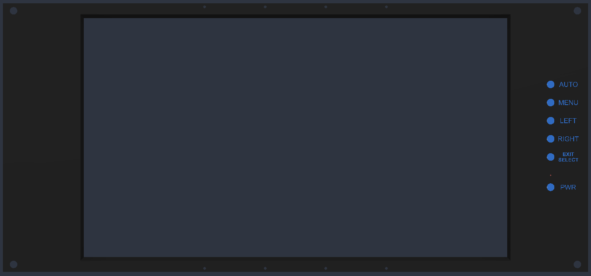
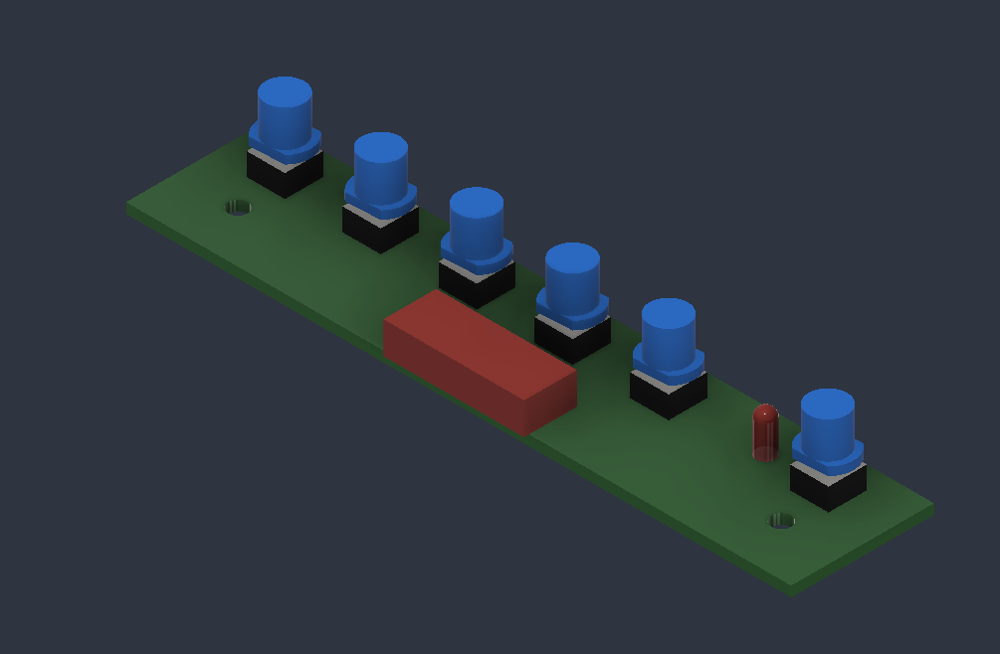

# 5U Rack Screen

> A 5U 19" rack-mounted display built from a salvaged Dell Vostro 1015 laptop panel and an off-the-shelf LVDS controller board, housed in a 3D-printed front panel.

<p align="center">
  
</p>

## Table of Contents

- [Overview](#overview)
- [Functionality](#functionality)
  - [Front Panel](#front-panel)
  - [Controls](#controls)
  - [Compatible Panels](#compatible-panels)
- [System Design](#system-design)
  - [Hardware](#hardware)
  - [Files](#files)
- [Bill of Materials](#bill-of-materials)
- [Author](#author)
- [AI Disclosure](#ai-disclosure)
- [License](#license)

## Overview

This project turns the 15.6" LCD from a disassembled Dell Vostro 1015 laptop into a standalone monitor that mounts in a standard 19" equipment rack. The panel is driven by a VSDISPLAY HDMI/VGA/DVI to LVDS controller board, and everything is held in a 3D-printed 5U front panel designed in Autodesk Fusion. The controller's button board mounts behind the panel, with printed button caps and labels on the front.

## Functionality

### Front Panel

| Feature | Details |
|---|---|
| Rack size | 5U, 19" standard rack width |
| Screen | 15.6" 1366x768 laptop LCD, centered in a recessed bezel |
| Mounting | Four corner holes for standard rack screws |
| Controls | Six labeled buttons and a power LED along the right side |

### Controls

The buttons come from the controller board's included keypad, extended to the front panel with printed 6 mm pushbutton covers.

| Button | Function |
|---|---|
| **AUTO** | Auto-adjust image (VGA input) |
| **MENU** | Open the on-screen display menu |
| **LEFT** / **RIGHT** | Navigate menu and adjust values |
| **EXIT / SELECT** | Confirm or back out of menu items |
| **PWR** | Power the display on and off |

<p align="center">
  
</p>

### Compatible Panels

The controller board supports any of these 15.6" 1366x768 40-pin LVDS panels, so the front panel can be reused with screens from other laptops:

| Panel |
|---|
| LP156WH2 |
| LP156WH3 |
| LP156WH4 |
| B156XW02 |
| N156B6-L0B |

## System Design

### Hardware

| Component | Details |
|---|---|
| Display | 15.6" 1366x768 LCD, salvaged from a Dell Vostro 1015 |
| Controller | VSDISPLAY HDMI/VGA/DVI to LVDS controller board, 40-pin |
| Inputs | HDMI, VGA, DVI (from controller board) |
| Front panel | 3D-printed, designed in Autodesk Fusion |
| Buttons | Controller keypad board with printed 6 mm pushbutton covers |

### Files

```
hardware/
  3d_models/
    5U 19_ Rack Screen.f3d            # 5U front panel and bezel
    6mm Pushbutton Cover.f3d          # Button cap for the keypad board
    Display Board Button PCB.f3d      # Reference model of the controller keypad board
    Rack Screen Assembly.f3z.f3d      # Full assembly
media/
  front_panel.png                     # Front panel render
  button_board.png                    # Keypad board render
```

## Bill of Materials

| Item | Qty |
|---|---|
| 15.6" 1366x768 40-pin LVDS LCD panel (Dell Vostro 1015 or compatible) | 1 |
| VSDISPLAY HDMI/VGA/DVI LVDS controller board with keypad | 1 |
| Power supply for controller board | 1 |
| 3D-printed 5U front panel | 1 |
| 3D-printed 6 mm pushbutton covers | 6 |
| Rack screws | 4 |

## Author

**Seth Hibpshman**  
Student of Electrical Engineering, Eastern Washington University

## AI Disclosure
_AI (LLM) tools assisted in drafting this README._

## License

[GNU General Public License v3.0](LICENSE)
